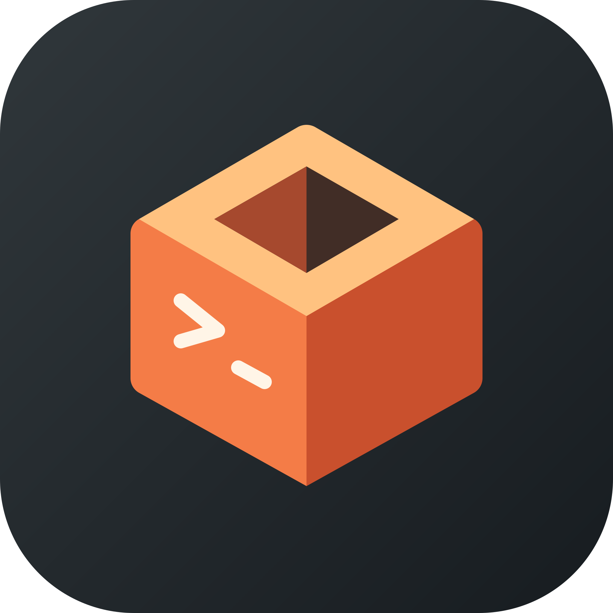

<div align="center">

<h1>ccBox</h1>

**Трымайце міс Клод у клетцы, каб мы маглі лепш абараніць наш час разам**



[MIT](LICENSE)

**[Сайт праекта](./docs/guide/installation.md) · [Спампаваць праграму](docs/guide/installation.md) · [Пачатак працы](docs/getting-started.md) · [FAQ](docs/troubleshooting.md) · [Дапаможнік (па-кітайску)](./docs/guide/index.md)**

[简体中文](README.md) · [繁體中文](README.zh-TW.md) · [Русский](README.ru.md) · [العربية](README.ar.md) · [فارسی](README.fa.md) · [한국어](README.ko.md) · [Español](README.es.md) · [မြန်မာဘာသာ](README.my.md) · [Беларуская](README.be.md) · [پښتو](README.ps.md) · [دری](README.prs.md) · [አማርኛ](README.am.md) · [Soomaali](README.so.md) · [ትግርኛ](README.ti.md) · [Français](README.fr.md)

</div>

## Надакучыла Anthropic

Як звычайныя карыстальнікі, якія проста хочуць паразмаўляць і супрацоўнічаць з Клодам, мы стаміліся ад наладжвання асобнікаў VPS, профіляў адбіткаў пальцаў у браўзеры і праверкі асяроддзя, адначасова турбуючыся аб забароне ўліковых запісаў і фінансавых стратах. Мы прадстаўляем **ccBox** — **гатовае да выкарыстання настольнае прыкладанне: наладзьце свой уласны сеткавы проксі і кіруйце ізаляваным асяроддзем, гадзінным поясам, мовай і праверкай асяроддзя ў адным месцы.**

ccBox аб’ядноўвае тэрмінал, браўзер, рэдактар і афіцыйны Claude Desktop у адным ізаляваным працоўным асяроддзі. Выкарыстоўвайце віртуальную macOS на Mac, Windows на сумяшчальным ПК або лёгкае асяроддзе Linux. Адкрывайце доступ да выбраных праектаў, кіруйце сеткай асобна, падключайце свой сервер праз SSH і працягвайце працу з тэлефона. Асноўныя магчымасці:

- Налады сеткі ізаляваны ад хаста; ccBox накіроўвае ўвесь сеткавы трафік унутр свайго асяроддзя праз уласны сеткавы проксі
- Налады адбіткаў пальцаў браўзера, ізаляваныя ад хаста, уключаючы гадзінны пояс і мову, з аўтаматычнай сінхранізацыяй з IP-месцазнаходжаннем сеткавага проксі
- Інтэграцыя ва ўвесь працоўны працэс Claude: уваход у браўзер, аўтарызацыя ўліковага запісу і працэс Claude Code
- Убудаваныя праверкі сеткі і ізаляцыі прыпыняюць доступ у Інтэрнэт, калі крытычныя праверкі не атрымліваюцца або доказы няпоўныя; праверкі супольнасці і трэціх асоб даюць дадатковую даведачную інфармацыю

**Вынікі праверкі асяроддзя з ccBox:**

## Што ты можаш зрабіць з ccBoxам

- **Праца ў адным акне.** Запусціце Claude Code у тэрмінале, праглядзіце змены ў рэдактары і выкарыстоўвайце браўзер ccBox для папярэдняга прагляду паслуг і ўваходу.
- **Распрацоўвайце ў звыклай сістэме.** Выберыце гасцявую macOS, Windows або Linux з адпаведнымі інструментамі ці клануйце сістэму хоста, стварыўшы чыстае незалежнае асяроддзе. [Выбар гасцявой сістэмы](docs/guide/guest-systems.md)
- **Кантралюйце, чым вы дзеліцеся.** Абагульваюцца толькі працоўная вобласць па змаўчанні і адкрытыя папкі праекта. Стан уваходу Claude, профілі браўзера і ключы SSH не імпартуюцца аўтаматычна.
- **Глядзіце стан вашай сеткі.** Убудаванае кіраванне сеткавым проксі-серверам дазваляе імпартаваць падпіскі, выбіраць канчатковыя кропкі і правяраць выхадны IP. Асяроддзе застаецца ў аўтаномным рэжыме, пакуль не пройдуць крытычныя праверкі. Калі сеткавы проксі-сервер недаступны, няма магчымасці вярнуцца да прамога злучэння.
- **Працягнуць у наступны раз.** Інструменты, файлы і стан уваходу захоўваюцца на віртуальным дыску. Фонавыя задачы могуць працягваць працаваць, калі вы зачыніце акно.
- **Кіруйце некалькімі акаўнтамі Claude Code.** Правярайце квоты, прызначайце акаўнты новым сеансам і з яўным дазволам мяняйце акаўнт з захаваннем гісторыі. [Claude Code](docs/guide/accounts.md)
- **Працягвайце з тэлефона.** Падключыце Android ці iPhone да камп’ютара праз QR-код або код спалучэння. Працягвайце тыя ж размовы Claude Code, адпраўляйце паведамленні, пацвярджайце інструменты і кіруйце аддаленым браўзерам ці акном Claude Desktop на камп’ютары.
- **Запускайце ccBox у воблаку.** Падключайцеся праз SSH да ccBox на сумяшчальным VPS з Linux x86_64 без KVM. Даныя і выхад у сетку знаходзяцца на серверы.
- **Падключайцеся праз прыватную сетку.** Увайдзіце ў Tailscale ўнутры ccBox для двухбаковага SSH паміж хостам і асяроддзем. [Tailscale / SSH](docs/guide/tailscale.md)

## Хуткі старт

Адпраўце гэты запыт свайму агенту штучнага інтэлекту (codex, dsh, workbuddy — верагодна, не Claude Code 😁):

```markdown
Дапамажыце ўсталяваць ccBox і наладзіць сеткавы проксі ccBox для выкарыстання канцавой кропкі xxx у маёй лакальнай устаноўцы Clash.
```

Усё, што вам трэба, гэта надзейная канчатковая кропка сеткавага проксі. Гэты праект не прасоўвае ніякіх проксі-правайдэраў; вы можаце знайсці пастаўшчыка самастойна, напрыклад, здзейсніўшы пошук на сайце Black Error.

## Спампоўка і ўстаноўка

ccBox падтрымлівае macOS, Windows і Linux: Apple Silicon з macOS 14+, Windows 10 22H2 / 11 x64 і Debian 12 / Ubuntu 22.04 / 24.04 x86_64. Intel Mac, Windows ARM64 і Linux ARM64 пакуль не падтрымліваюцца. [macOS](docs/getting-started.md) · [Windows](docs/windows.md) · [Linux](docs/linux.md).

1. Спампаваць праграму: [macOS / Windows / Linux](docs/guide/installation.md).
2. macOS: Адкрыйце ўсталявальны пакет і перацягнуць **ccBox** у **Прыкладанні**; затым запусціце яго з праграм. Windows: [Інструкцыя па ўсталяванні](docs/windows.md#安装并开始工作) · Linux: [Інструкцыя па ўсталяванні](docs/linux.md#安装并开始工作).
3. Выконвайце інструкцыі ў дадатку, каб наладзіць свой уласны сеткавы проксі, запусціць асяроддзе і адкрыць праект.

Усталёўшчык змяшчае працоўнае асяроддзе і ядро проксі. Загадзя ўсталёўваць Go, Node.js, Docker ці Clash не трэба. Пры стварэнні выберыце гасцявую сістэму і месца захоўвання, затым падрыхтуйце афіцыйны вобраз і інструменты. ccBox не дае ліцэнзій АС, паслуг проксі ці акаўнтаў Claude.

Зыходны код і ўсталёўшчыкі публічныя. Заўвагі да версій і кантрольныя сумы даступныя ў [Releases](docs/guide/installation.md).

Магчымасці залежаць ад зборкі; магчымасці і аб’ём праверкі публічнага ўсталёўшчыка пазначаны ў нататках да выпуску.

macOS і падпісаныя версіі Windows абнаўляюцца праз выбраны проксі. Непадпісаная папярэдняя версія Windows і Linux абнаўляюцца ўручную ўсталёўшчыкам. Перад абнаўленнем захавайце і спыніце задачы; асабістыя даныя захоўваюцца. [Абнаўленне і выдаленне](docs/guide/maintenance.md)

## Пачніце ў тры этапы

### 1. Выберыце сеткавы проксі

На галоўнай старонцы націсніце «Наладзіць сетку і проксі», затым «Дадаць крыніцу». Імпартуйце падпіску Clash/Mihomo YAML або лакальны файл YAML і абярыце канечную кропку ў раздзеле «Вузлы». Калі сеткавы проксі недаступны, вы можаце яўна выбраць «Спампаваць гэтую падпіску праз хаст-сетку» або непасрэдна імпартаваць лакальны файл. Пазней кіруйце канчатковымі кропкамі ў раздзеле «Настройкі → Сетка і проксі».

### 2. Пачаць асяроддзе

Пры першым запуску выберыце гасцявую сістэму або кланаванне сістэмы хоста і месца захоўвання. Запусціце асяроддзе ccBox, завяршыце ўсталяванне і патрэбныя дазволы. Прагрэс і памылкі даступныя ў дэталях аперацыі. Наступныя запускі выкарыстоўваюць тое ж асяроддзе.

### 3. Адкрыйце праект і запусціце Claude

Націсніце «Адкрыць праект», каб выбраць тэчку на вашым камп’ютары, адкрыць новы тэрмінал і ўвайсці `claude`; затым аўтарызуйце свой уліковы запіс у браўзеры ccBox. Вы таксама можаце пачаць з працоўнай вобласці па змаўчанні без падрыхтоўкі праекта. Поўныя крокі гл [Пачатак працы](docs/getting-started.md).

## Зразумейце гэтыя абмежаванні перад выкарыстаннем

- Рэдагаванні і выдаленні ў агульных праектах непасрэдна ўплываюць на файлы на вашым камп’ютары. Выкарыстоўвайце кантроль версій або рэзервовыя копіі. Каталог `.git` праекта даступны для чытання і запісу; у ccBox можна індэксаваць змены, ствараць каміты і пераключаць галіны.
- Усе праекты выкарыстоўваюць адно асяроддзе ccBox, уключаючы яго інструменты, уліковыя запісы і файлавую сістэму macOS / Windows / Debian / Ubuntu 22.04. Праекты не ізаляваныя адзін ад аднаго.
- Па змаўчанні публічны выходны трафік падтрымлівае IPv4 TCP, а DNS ідзе праз той жа проксі. Публічныя UDP, IPv6, ICMP і прамы доступ да хоста або лакальнай сеткі абмежаваныя. Пасля яўнага ўключэння Tailscale доступ да прылад вызначаюць правілы прыватнай сеткі.
- Сеткавыя праверкі паказваюць бягучую канфігурацыю і выбарку доказаў. Яны не могуць гарантаваць, што ўліковы запіс пазбегне абмежаванняў платформы, і не замяняюць поўны аўдыт бяспекі віртуалізацыі.

Падрабязней гл [Межы сеткі і дадзеных](docs/getting-started.md#网络与数据边界).

## Дакументацыя і ўклады

Поўны паказальнік гл [Індэкс дакументацыі](docs/README.md).

| Ваша задача | Пачаць тут |
|---|---|
| macOS / Windows / Debian / Ubuntu 22.04 | [Выбар гасцявой сістэмы](./docs/guide/guest-systems.md) |
| Усталюйце, наладзьце сеткавы проксі і адкрыйце свой першы праект | [Пачатак працы](docs/getting-started.md) |
| Выпраўленне непаладак спампоўкі, запуску, падключэння і ўваходу ў сістэму | [FAQ і аднаўленне](docs/troubleshooting.md) |
| Вывучыце элементы кіравання з клавіятуры, знешні выгляд, захаванне даных і паводзіны пры выхадзе | [Штодзённае выкарыстанне](docs/getting-started.md#日常使用) |

Праект імкліва развіваецца. Далучайцеся да групы супольнасці, каб падзяліцца водгукамі; вітаюцца супрацоўнікі супольнасці.

## Паходжанне і ліцэнзаванне

Клетка паходзіць ад agent-vm.

Асноўная ліцэнзія праекта [MIT](LICENSE). Кампаненты ў камплекце захоўваюць адпаведныя ліцэнзіі. Mihomo распаўсюджваецца як асобны выкананы файл пад GPL-3.0. Таксама гл [NOTICE](NOTICE) · [Ліцэнзіі іншых вытворцаў](THIRD_PARTY_LICENSES) · [noVNC](ui/vendor/novnc/LICENSE.txt)。

ccBox з'яўляецца незалежным грамадскім праектам і не звязаны з Anthropic.

## Спасылкі і падзякі

Дзякуй наступным праектам за асноўныя магчымасці і дызайнерскія спасылкі:

- agent-vm: верхні падмурак ccBoxа.
- Lima: Кіраванне віртуальнай машынай Linux.
- gvisor-tap-vsock: сетка віртуальнай машыны.
- sshocker і SFTP: абмен файламі паміж віртуальнай машынай і хостам.
- noVNC: дыстанцыйнае адлюстраванне і ўзаемадзеянне ў браўзеры.
- Mihomo: убудаванае сеткавае ядро ​​проксі.
- code-server: рэдактар ​​кода на аснове браўзера.
- AIO Sandbox: спасылкі на дызайн працоўнага асяроддзя і ўзаемадзеяння.
- claude-switcher і Claude-Guardian: спасылкі для праверкі сеткі і дыягностыкі бяспекі.
