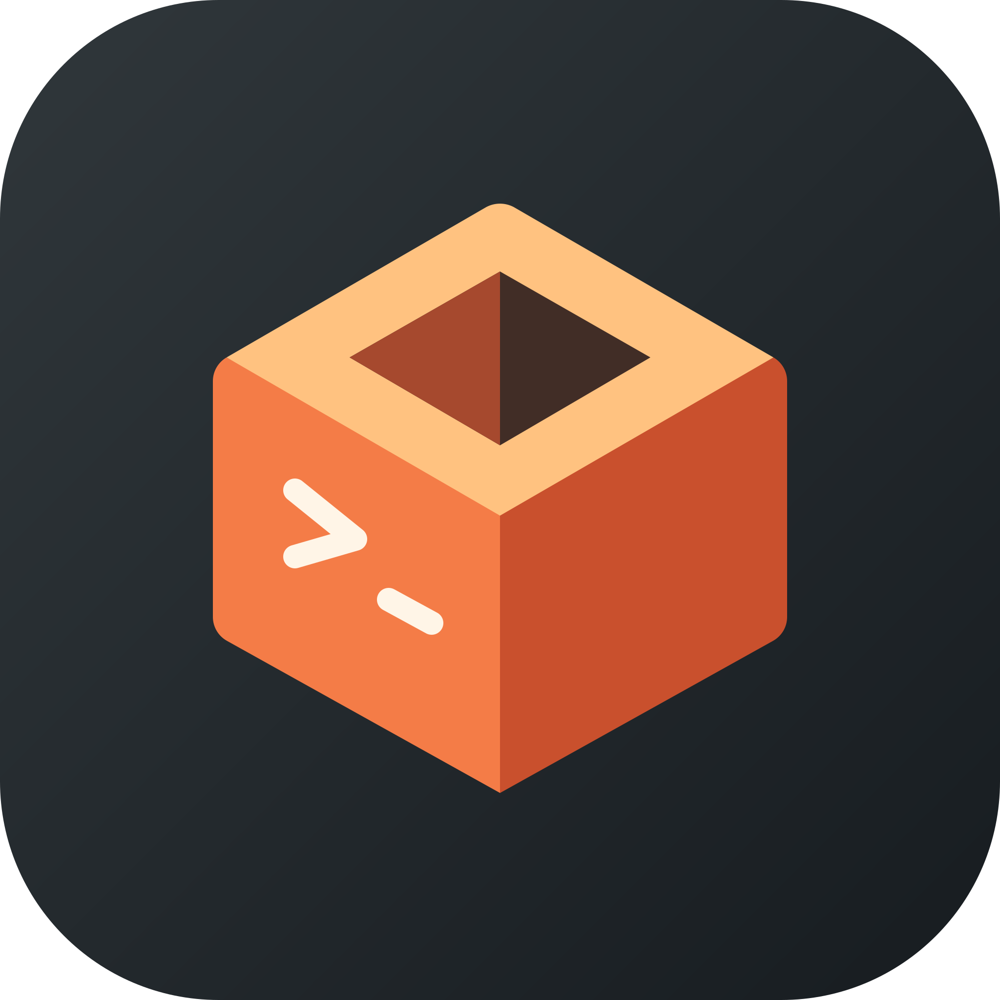
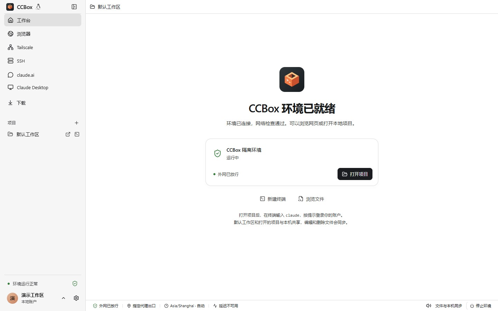

<div align="center">

<h1>CCBox</h1>

**Keep Claude in a box — to better protect our time together**



[MIT](LICENSE)

**[Project home](./docs/guide/installation.md) · [Download](#download-and-install) · [User guide (Chinese)](./docs/guide/index.md) · [FAQ (Chinese)](./docs/guide/troubleshooting.md)**

[简体中文](README.md) · [繁體中文](README.zh-TW.md) · [English](README.en.md)

</div>

## Fed up with Anthropic

As ordinary users who just want to talk and work with Claude, we got tired of juggling VPS instances, fingerprint browsers and environment checks, and of worrying about account bans and lost money. So we built **CCBox**: **a ready-to-use desktop app where you configure your own network proxy and manage the isolated environment, time zone, language and environment checks in one place.**

CCBox lets you work with Claude in a system you know: a macOS virtual machine on a Mac, a Windows virtual machine on Windows, or a lightweight Linux environment. Terminal, browser, editor and the official Claude Desktop share one workbench; projects are shared only when you choose, and the network is managed separately. You can also connect your own server, or pick up tasks from your phone. Key features:

- Network settings isolated from the host; CCBox routes all network traffic inside its environment through its own proxy
- Fingerprint settings isolated from the host, including time zone and language, which can follow the proxy IP automatically
- End-to-end support for the Claude workflow (browser sign-in, authorization, the Claude Code process)
- Built-in network and isolation checks keep the environment offline when a critical check fails or evidence is incomplete; community and third-party checks add further reference



## What you can do with it

- **Work in one window.** Run Claude Code in the terminal, review changes in the editor, and use the CCBox browser to preview services and sign in.
- **Develop on a familiar system.** Choose a macOS, Windows or Linux guest and use that platform's tools; or match your host's system version automatically, download the official image and create an independent environment. [Choose a guest system](docs/guide/guest-systems.md)
- **Control what you share.** Only the default workspace and project folders you explicitly open are shared; the host's Claude sign-in, browser profiles and SSH keys are never imported automatically.
- **See your network status.** Built-in proxy management imports subscriptions, selects nodes and checks the exit IP. The environment stays offline until critical checks pass, and there is no direct-connection fallback when the proxy is unavailable.
- **Pick up where you left off.** Tools, files and sign-in state persist on the virtual disk, and background tasks can keep running after you close the window.
- **Manage several Claude Code subscriptions.** Check quotas, assign accounts to new sessions, and with explicit permission switch accounts while keeping history. [Claude Code](docs/guide/accounts.md)
- **Continue from your phone.** Pair an Android phone or iPhone with your computer to continue Claude Code conversations and tool approvals, or operate the remote browser and Claude Desktop. [Mobile](docs/guide/mobile.md)
- **Put the environment on your own server.** Deploy to or connect a Linux VPS over SSH; tools, tasks and data stay on the server, no KVM required. [Cloud and SSH](docs/guide/cloud.md)
- **Reach devices over a private network.** Sign in to Tailscale inside CCBox, see the devices on your network, and use SSH, web and other TCP services. [Tailscale](docs/guide/tailscale.md)

Browser bookmarks, private sessions, cookies, extensions, the password vault, plus appearance, resources, storage and tool updates are covered in the [full user guide](./docs/guide/index.md).

## Quick start

Send this to your agent (Codex, WorkBuddy — anything but Claude Code 😁):

```markdown
Install CCBox for me and set CCBox's proxy to the xxx node of my local Clash.
```

All you need is a reliable proxy node. This project does not promote any proxy provider.

## Download and install

CCBox supports macOS, Windows and Linux: Apple Silicon Macs on macOS 14+, Windows 10 22H2 / 11 x64, and Debian 12 / Ubuntu 22.04 / 24.04 x86_64. A Windows 11 guest needs a Windows 11 Pro, Enterprise or Education host with Hyper-V; other supported Windows hosts can use Debian or Ubuntu 22.04. Intel Macs, Windows ARM64 and Linux ARM64 are not supported yet. [macOS](docs/getting-started.md) · [Windows](docs/windows.md) · [Linux](docs/linux.md).

1. Get the installer for your platform from your CCBox distributor, or build from source following the platform guide.
2. macOS: open the disk image, drag **CCBox** into **Applications** and launch it from there. Windows: [installation](docs/windows.md#安装并开始工作) · Linux: [installation](docs/linux.md#安装并开始工作).
3. Follow the in-app guide to configure your own proxy, start the environment and open a project.

The installer includes the workbench and the proxy core; you do not need Go, Node.js, Docker or Clash first. When you create the environment for the first time, choose the guest system and storage location, then CCBox prepares the official system image and development tools. macOS and Windows are used under their own licenses; CCBox does not provide system licenses, proxy services or Claude accounts.

Verify the SHA-256 provided by your distributor before installing. Guest choices, image sources and data retention are described in the [guest system guide](docs/guide/guest-systems.md).

Features depend on the build you use; the capabilities and verification scope of public installers are stated in the release notes.

CCBox is updated manually with a new installer. Save and stop your tasks before updating. [Upgrade and uninstall](docs/guide/maintenance.md)

## Get started in three steps

### 1. Choose a proxy

Import a Clash/Mihomo YAML subscription or local configuration, select a node and click "Apply proxy"; configure a proxy chain when you need a relay. [Network and proxy](docs/guide/network.md)

### 2. Start the environment

The first time, choose a guest system or "match my host's system version", then a storage location. Click "Install guest" or "Start CCBox environment" and follow the installation and authorization prompts; progress and errors are shown under "Operation details". Later launches reuse the same environment.

### 3. Open a project and run Claude

Click "Open project" to choose a folder on your computer, open a new terminal, type `claude`, and authorize your own account in the CCBox browser. You can also start in the default workspace without preparing a project. See [Getting started](docs/getting-started.md) for the full steps.

## Know these limits before you start

- **Shared projects are your real files.** Edits and deletions in shared projects, including Git operations, change the original files on your computer. Use version control or backups and review your commits.
- **Projects are not isolated from each other.** Projects in the same CCBox configuration share the guest system, tools, accounts and file system. Switching guest systems needs a separate installation; data in the original environment is kept.
- **Network access is deliberately limited.** By default public egress supports IPv4 TCP, and DNS goes through the same proxy; public UDP, IPv6, ICMP and direct connections to the host or LAN are restricted. Once you enable Tailscale, devices are reachable according to your private network's permissions.
- **Checks are evidence, not a guarantee.** Network checks show the current configuration and sampled evidence; they cannot guarantee that an account will avoid platform restrictions and do not replace a full virtualization security audit.

See [Network and data boundaries](docs/getting-started.md#网络与数据边界) for details.

## Documentation and contributing

The [user guide](./docs/guide/index.md) on the website can be browsed by feature, searched, and linked by section; it is currently written in Chinese. See the [guide index](docs/README.md) for every task.

| What you want to do | Start here |
|---|---|
| Let your own agent download, install, configure and troubleshoot CCBox | [Agent guide](./docs/guide/agent.md) |
| Install for the first time, configure a proxy, open a project | [Installation and first launch](./docs/guide/installation.md) |
| Choose a macOS, Windows, Debian or Ubuntu 22.04 guest and use native tools | [Choose a guest system](./docs/guide/guest-systems.md) |
| Add several subscriptions, check quotas and assign terminals | [Accounts and quotas](./docs/guide/accounts.md) |
| Pair a phone, approve tools, use the remote browser | [Mobile and remote sessions](./docs/guide/mobile.md) |
| Deploy and connect an environment on your own VPS | [Cloud and SSH](./docs/guide/cloud.md) |
| Learn every setting and when it takes effect | [Settings reference](./docs/guide/settings.md) |
| Maintain storage, resources, updates and backups | [Maintenance, resources and data](./docs/guide/maintenance.md) |
| Fix download, startup, network and sign-in problems | [Troubleshooting](./docs/guide/troubleshooting.md) |
| Understand files, keys, and close and quit behavior | [Projects, terminals and files](./docs/guide/workbench.md) |

The project is evolving quickly. Join the community group to share feedback; maintainers from the community are welcome.

## Origins and license

CCBox is developed from Claude Cage, which is based on agent-vm.

The project's main license is [MIT](LICENSE). Bundled components keep their own licenses, and Mihomo is distributed as a separate executable under GPL-3.0; see also [NOTICE](NOTICE) · [Third-party licenses](THIRD_PARTY_LICENSES) · [noVNC](ui/vendor/novnc/LICENSE.txt).

CCBox is an independent community project and is not affiliated with Anthropic.

## References and thanks

Thanks to the following projects for foundations and design references:

- agent-vm: the base CCBox is developed from.
- Lima: virtual machine management and the runtime for macOS and Linux guests.
- gvisor-tap-vsock: virtual machine networking.
- sshocker and SFTP: file sharing between the virtual machine and the host.
- noVNC: remote display and interaction in the browser.
- Mihomo: the built-in proxy core.
- code-server: the code editor in the browser.
- AIO Sandbox: references for the work environment and interaction design.
- claude-switcher and Claude-Guardian: references for network checks and security diagnostics.
