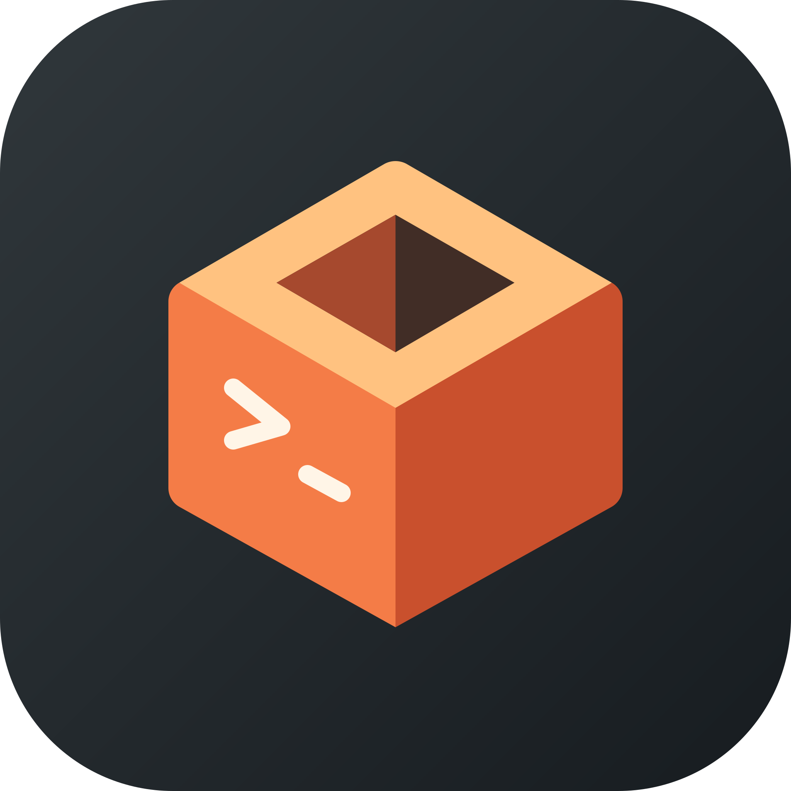

<div align="center">

<h1>ccBox</h1>

**خانم Claude را در ccBox نگه دارید تا بتوانیم از زمان با هم بودنمان بهتر محافظت کنیم**



[MIT](LICENSE)

**[وب سایت پروژه](./docs/guide/installation.md) · [دانلود برنامه](docs/guide/installation.md) · [شروع کردن](docs/getting-started.md) · [سوالات متداول](docs/troubleshooting.md) · [راهنمای استفاده (چینی)](./docs/guide/index.md)**

[简体中文](README.md) · [繁體中文](README.zh-TW.md) · [Русский](README.ru.md) · [العربية](README.ar.md) · [فارسی](README.fa.md) · [한국어](README.ko.md) · [Español](README.es.md) · [မြန်မာဘာသာ](README.my.md) · [Беларуская](README.be.md) · [پښتو](README.ps.md) · [دری](README.prs.md) · [አማርኛ](README.am.md) · [Soomaali](README.so.md) · [ትግርኛ](README.ti.md) · [Français](README.fr.md)

</div>

## از Anthropic خسته شده‌ایم

به عنوان کاربران عادی که فقط می‌خواهیم با Claude صحبت و همکاری کنیم، از پیکربندی نمونه‌های VPS، نمایه‌های اثر انگشت مرورگر و بررسی‌های محیطی خسته شده‌ایم، در حالی که نگران ممنوعیت حساب‌ها و ضررهای مالی هستیم. ارائه می کنیم **ccBox** -**یک برنامه دسکتاپ آماده برای استفاده: پروکسی شبکه خود را پیکربندی کنید و بررسی های محیط ایزوله، منطقه زمانی، زبان و محیط را در یک مکان مدیریت کنید.**

ccBox ترمینال، مرورگر، ویرایشگر و برنامهٔ رسمی Claude Desktop را در یک فضای کاری جدا گرد هم می‌آورد. روی Mac از ماشین مجازی macOS، روی رایانهٔ Windows سازگار از Windows، یا از محیط سبک Linux استفاده کنید. پروژه‌های دلخواه را به اشتراک بگذارید، شبکه را جداگانه مدیریت کنید، با SSH به سرور خود وصل شوید و کارها را از تلفن ادامه دهید. قابلیت‌های اصلی:

- تنظیمات شبکه جدا شده از میزبان؛ ccBox تمام ترافیک شبکه را در داخل محیط خود از طریق پراکسی شبکه خود هدایت می کند
- تنظیمات اثر انگشت مرورگر جدا شده از میزبان، از جمله منطقه زمانی و زبان، با همگام‌سازی خودکار با مکان IP پروکسی شبکه
- ادغام در سراسر گردش کار Claude: ورود به سیستم مرورگر، مجوز حساب، و فرآیند Claude کد
- شبکه داخلی و بررسی های ایزوله دسترسی به اینترنت را زمانی که بررسی های حیاتی با شکست مواجه می شوند یا شواهد ناقص هستند متوقف می کند. چک های جامعه و شخص ثالث اطلاعات مرجع بیشتری را ارائه می دهند

**نتایج بررسی محیط با ccBox:**

## کاری که می توانید با ccBox انجام دهید

- **در یک پنجره واحد کار کنید.** Claude Code را در ترمینال اجرا کنید، تغییرات ویرایشگر را بررسی کنید و از مرورگر ccBox برای پیش نمایش خدمات و ورود به سیستم استفاده کنید.
- **در سیستم آشنا توسعه دهید.** سیستم مهمان macOS، Windows یا Linux را با ابزارهای همان پلتفرم انتخاب کنید، یا سیستم میزبان را برای ساخت محیطی مستقل و پاک شبیه‌سازی کنید. [انتخاب سیستم مهمان](docs/guide/guest-systems.md)
- **آنچه را که به اشتراک می گذارید کنترل کنید.** فقط فضای کاری پیش‌فرض و پوشه‌های پروژه به‌صراحت باز شده به اشتراک گذاشته می‌شوند. وضعیت ورود به سیستم Claude میزبان، نمایه‌های مرورگر و کلیدهای SSH به‌طور خودکار وارد نمی‌شوند.
- **وضعیت شبکه خود را ببینید.** مدیریت پروکسی شبکه داخلی به شما امکان می‌دهد اشتراک‌ها را وارد کنید، نقاط پایانی را انتخاب کنید و IP خروجی را بررسی کنید. محیط آفلاین می‌ماند تا زمانی که بررسی‌های حیاتی با موفقیت انجام شوند. اگر پراکسی شبکه در دسترس نباشد، هیچ بازگشتی به اتصال مستقیم وجود ندارد.
- **دفعه بعد ادامه بده** ابزارها، فایل‌ها و وضعیت ورود به سیستم روی دیسک مجازی باقی می‌مانند. وقتی پنجره را می‌بندید، کارهای پس‌زمینه می‌توانند همچنان اجرا شوند.
- **چند حساب Claude Code را مدیریت کنید.** سهمیه‌ها را ببینید، به نشست‌های جدید حساب اختصاص دهید و با اجازهٔ صریح، حساب را برای ادامهٔ تاریخچه تغییر دهید. [Claude Code](docs/guide/accounts.md)
- **از تلفن ادامه دهید.** Android یا iPhone را با کد QR یا کد جفت‌سازی به رایانه وصل کنید. همان گفت‌وگوهای Claude Code را ادامه دهید، پیام بفرستید، ابزارها را تأیید کنید و مرورگر راه دور یا پنجرهٔ Claude Desktop رایانه را به کار ببرید.
- **ccBox را در فضای ابری اجرا کنید.** از طریق SSH به ccBox مستقر روی VPS سازگار با Linux x86_64 وصل شوید؛ KVM لازم نیست. داده‌ها و خروجی شبکه روی سرور قرار دارند.
- **از شبکهٔ خصوصی وصل شوید.** در ccBox وارد Tailscale شوید تا میزبان و محیط از هر دو جهت با SSH به هم وصل شوند. [Tailscale / SSH](docs/guide/tailscale.md)

## شروع سریع

این درخواست را برای عامل هوش مصنوعی خود (codex، dsh، workbuddy - احتمالاً Claude Code) ارسال کنید:

```markdown
کمکم کن نصب کنم ccBox و پروکسی شبکه ccBox را برای استفاده از نقطه پایانی xxx در نصب محلی Clash من پیکربندی کنید.
```

تنها چیزی که نیاز دارید یک نقطه پایانی پروکسی شبکه قابل اعتماد است. این پروژه هیچ ارائه دهنده پروکسی را تبلیغ نمی کند. می توانید خودتان یک ارائه دهنده پیدا کنید، برای مثال با جستجوی وب سایت Black Error.

## دانلود و نصب کنید

ccBox از macOS، Windows و Linux پشتیبانی می‌کند: Apple Silicon با macOS 14+، Windows 10 22H2 / 11 x64 و Debian 12 / Ubuntu 22.04 / 24.04 x86_64. Intel Mac، Windows ARM64 و Linux ARM64 فعلاً پشتیبانی نمی‌شوند. [macOS](docs/getting-started.md) · [Windows](docs/windows.md) · [Linux](docs/linux.md).

1. دانلود برنامه: [macOS / Windows / Linux](docs/guide/installation.md).
2. macOS: بسته نصب را باز کرده و بکشید **ccBox** به **برنامه های کاربردی**; سپس آن را از Applications اجرا کنید. Windows: [راهنمای نصب](docs/windows.md#安装并开始工作) · Linux: [راهنمای نصب](docs/linux.md#安装并开始工作).
3. دستورالعمل های درون برنامه را دنبال کنید تا پروکسی شبکه خود را پیکربندی کنید، محیط را راه اندازی کنید و یک پروژه را باز کنید.

بستهٔ نصب شامل فضای کاری و موتور پراکسی است. نیازی به نصب قبلی Go، Node.js، Docker یا Clash نیست. هنگام ساخت محیط، سیستم مهمان و محل ذخیره را انتخاب و تصویر رسمی و ابزارها را آماده کنید. ccBox مجوز سیستم‌عامل، سرویس پراکسی یا حساب Claude ارائه نمی‌کند.

کد منبع و بسته‌های نصب عمومی هستند. یادداشت نسخه‌ها و فایل‌های بررسی صحت در [Releases](docs/guide/installation.md) قرار دارند.

قابلیت‌ها به ساخت مورد استفاده بستگی دارند؛ قابلیت‌ها و دامنهٔ بررسی نصب‌کنندهٔ عمومی در یادداشت انتشار آمده‌اند.

macOS و نسخه‌های امضاشدهٔ Windows از پراکسی انتخابی به‌روز می‌شوند. پیش‌نمایش بدون امضای Windows و Linux با نصب‌کننده به‌صورت دستی به‌روز می‌شوند. ابتدا کارها را ذخیره و متوقف کنید؛ داده‌های شخصی حفظ می‌شوند. [به‌روزرسانی و حذف](docs/guide/maintenance.md)

## در سه مرحله شروع کنید

### 1. یک پروکسی شبکه را انتخاب کنید

در صفحه اصلی، روی «پیکربندی شبکه و پروکسی» و سپس «افزودن منبع» کلیک کنید. یک اشتراک Clash/Mihomo YAML یا یک فایل YAML محلی را وارد کنید و یک نقطه پایانی را در زیر «Nodes» انتخاب کنید. اگر هیچ پروکسی شبکه در دسترس نیست، می‌توانید صراحتاً «دانلود این اشتراک از طریق شبکه میزبان» را انتخاب کنید یا یک فایل محلی را مستقیماً وارد کنید. بعداً، نقاط پایانی را در قسمت «تنظیمات → شبکه و پروکسی» مدیریت کنید.

### 2. محیط را شروع کنید

در ساخت نخست، سیستم مهمان یا تکثیر سیستم میزبان و محل ذخیره را انتخاب کنید. محیط ccBox را راه‌اندازی کرده و مراحل نصب و مجوزها را دنبال کنید. پیشرفت و خطاها در جزئیات عملیات دیده می‌شوند. راه‌اندازی‌های بعدی همان محیط را به کار می‌برند.

### 3. یک پروژه را باز کنید و Claude را اجرا کنید

برای انتخاب یک پوشه در رایانه، روی «باز کردن پروژه» کلیک کنید، یک ترمینال جدید باز کنید و وارد شوید `claude`; سپس حساب خود را در مرورگر ccBox مجاز کنید. همچنین می توانید بدون تهیه پروژه با فضای کاری پیش فرض شروع کنید. برای مشاهده کامل مراحل، نگاه کنید [شروع کردن](docs/getting-started.md).

## قبل از استفاده این محدودیت ها را درک کنید

- ویرایش‌ها و حذف‌ها در پروژه‌های مشترک مستقیماً روی فایل‌های رایانه شما تأثیر می‌گذارد. از کنترل نسخه یا نسخه پشتیبان استفاده کنید. پوشهٔ `.git` پروژه خواندنی و نوشتنی است؛ می‌توانید در ccBox تغییرات را آماده و ثبت کنید و شاخه را تغییر دهید.
- همه پروژه ها یک محیط ccBox شامل ابزارها، حساب ها و سیستم فایل لینوکس را به اشتراک می گذارند. پروژه ها از یکدیگر جدا نیستند.
- خروجی عمومی به‌طور پیش‌فرض IPv4 TCP را پشتیبانی می‌کند و DNS از همان پراکسی می‌گذرد. UDP، IPv6 و ICMP عمومی و اتصال مستقیم به میزبان یا شبکهٔ محلی محدودند. با فعال‌سازی صریح Tailscale، دسترسی به دستگاه‌ها تابع مجوزهای شبکهٔ خصوصی است.
- بررسی های شبکه پیکربندی فعلی و شواهد نمونه برداری شده را نشان می دهد. آن‌ها نمی‌توانند تضمین کنند که یک حساب از محدودیت‌های پلتفرم جلوگیری می‌کند، و جایگزین ممیزی امنیتی کامل مجازی‌سازی نمی‌شوند.

برای جزئیات، نگاه کنید [مرزهای شبکه و داده](docs/getting-started.md#网络与数据边界).

## اسناد و مشارکت

برای نمایه کامل، نگاه کنید [نمایه اسناد و مدارک](docs/README.md).

| وظیفه شماست | از اینجا شروع کنید |
|---|---|
| macOS / Windows / Debian / Ubuntu 22.04 | [انتخاب سیستم مهمان](./docs/guide/guest-systems.md) |
| یک پروکسی شبکه را نصب کنید، پیکربندی کنید و اولین پروژه خود را باز کنید | [شروع کردن](docs/getting-started.md) |
| عیب‌یابی دانلود، راه‌اندازی، اتصال و ورود به سیستم | [سوالات متداول و بازیابی](docs/troubleshooting.md) |
| کنترل های صفحه کلید، ظاهر، ماندگاری داده ها و رفتار خروج را بیاموزید | [استفاده روزانه](docs/getting-started.md#日常使用) |

این پروژه به سرعت در حال پیشرفت است. برای به اشتراک گذاشتن بازخورد به گروه جامعه بپیوندید. از نگهبانان جامعه استقبال می شود.

## مبدا و مجوز

ccBox مشتق شده از agent-vm.

مجوز اصلی پروژه می باشد [MIT](LICENSE). اجزای همراه مجوز مربوطه خود را حفظ می کنند. Mihomo به عنوان یک فایل اجرایی جداگانه تحت GPL-3.0 توزیع شده است. همچنین ببینید [NOTICE](NOTICE) · [مجوزهای شخص ثالث](THIRD_PARTY_LICENSES) · [noVNC](ui/vendor/novnc/LICENSE.txt)。

ccBox یک پروژه اجتماعی مستقل است و به آنتروپیک وابسته نیست.

## مراجع و قدردانی

با تشکر از پروژه های زیر برای قابلیت های اساسی و مراجع طراحی:

- agent-vm: پایه بالادست ccBox.
- Lima: مدیریت ماشین مجازی لینوکس.
- gvisor-tap-vsock: شبکه ماشین مجازی.
- sshocker و SFTP: به اشتراک گذاری فایل بین ماشین مجازی و میزبان.
- noVNC: نمایش از راه دور و تعامل در مرورگر.
- Mihomo: هسته پروکسی شبکه داخلی.
- code-server: ویرایشگر کد مبتنی بر مرورگر.
- AIO Sandbox: مراجع برای طراحی محیط کار و تعامل.
- claude-switcher و Claude-Guardian: مراجع برای بررسی شبکه و تشخیص امنیتی.
