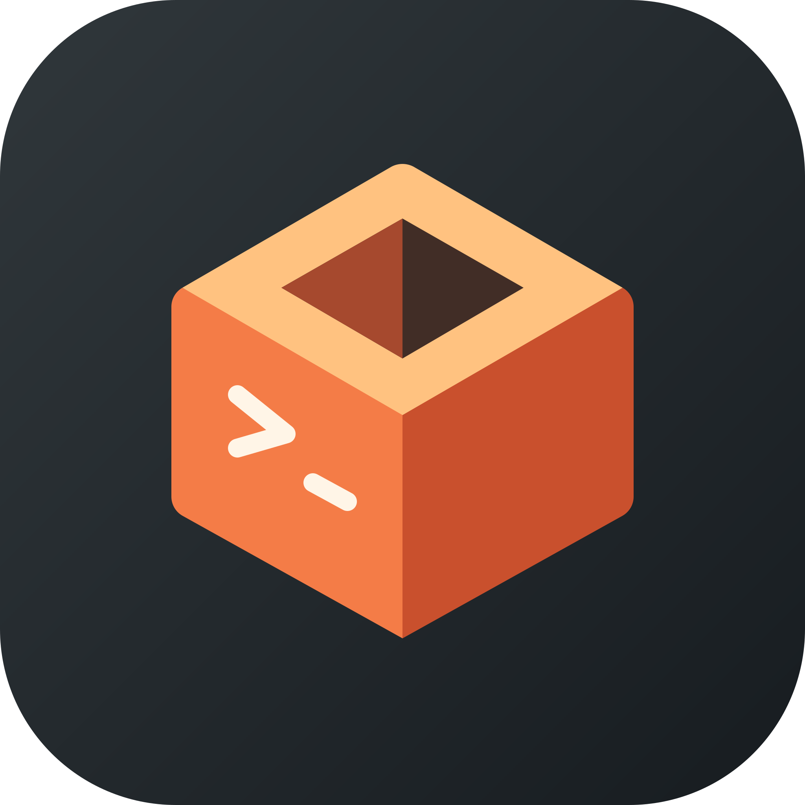

<div align="center">

<h1>CCBox</h1>

**Ku hay Miss Claude qafis, si aan si wanaagsan u ilaalin karno waqtigeena wada jirka ah**



[MIT](LICENSE)

**[Mareegta mashruuca](./docs/guide/installation.md) · [Soo dejiso abka](docs/guide/installation.md) · [Bilaabidda](docs/getting-started.md) · [FAQ](docs/troubleshooting.md) · [Hagaha isticmaalka (Shiine)](./docs/guide/index.md)**

[简体中文](README.md) · [繁體中文](README.zh-TW.md) · [Русский](README.ru.md) · [العربية](README.ar.md) · [فارسی](README.fa.md) · [한국어](README.ko.md) · [Español](README.es.md) · [မြန်မာဘာသာ](README.my.md) · [Беларуская](README.be.md) · [پښتو](README.ps.md) · [دری](README.prs.md) · [አማርኛ](README.am.md) · [Soomaali](README.so.md) · [ትግርኛ](README.ti.md) · [Français](README.fr.md)

</div>

## Waan ka daalnay Anthropic

Isticmaalayaasha caadiga ah ee raba inay la hadlaan Claude, waanu ka daalnay habaynta tusaalooyinka VPS, sawirka faraha browserka, iyo hubinta deegaanka, anagoo ka walwalsanayn xayiraadaha akoonnada iyo khasaaraha maaliyadeed. Waxaan soo bandhigaynaa **CCBox** -**codsi desktop diyaar u ah in la isticmaalo: habayso wakiilkaaga shabakad oo maamul deegaankaaga go'doonsan, aagga wakhtiga, luqadda, iyo hubinta deegaanka ee hal meel ah.**

CCBox wuxuu terminalka, biraawsarka, tafatiraha iyo Claude Desktop-ka rasmiga ah ku mideeyaa hal goob shaqo oo go’doonsan. Ku isticmaal macOS mashiin macmal ah oo Mac ah, Windows kombiyuutar la jaanqaadaya, ama deegaan Linux fudud. Wadaag mashaariicda aad doorato, shabakadda si gaar ah u maamul, serverkaaga SSH ku xir, hawlahana telefoonka ka sii wad. Astaamaha ugu waaweyn:

- Dejinta shabakada oo ka go'an martigeliyaha; Dariiqyada qafisku waxay maraa dhammaan taraafikada shabakada gudaha deegaankeeda iyada oo u sii marinaysa wakiilkeeda shabakadeeda
- Dejinta faraha browserka ee ka go'doon martigeliyaha, oo ay ku jiraan aaga wakhtiga iyo luqadda, oo leh si toos ah ula mid ah goobta wakiilka shabakada
- Isku dhafka inta lagu jiro socodka shaqada Claude: soo gelida browserka, oggolaanshaha akoontiga, iyo nidaamka Claude Code
- Shabakad la dhisay iyo jeegaga go'doominta ayaa hakiya gelitaanka intarneedka marka hubinta muhiimka ahi ay fashilmaan ama caddayntu aanay dhammaystirnayn; jeegaga bulshada iyo qolo saddexaad waxay bixiyaan macluumaad tixraac dheeraad ah

**Natiijooyinka hubinta deegaanka ee CCBox:**

## Maxaad ku samayn kartaa CCBox

- **Ka shaqee hal daaqad.** Orod Claude Code gudaha terminalka, dib u eeg isbeddelada tifaftiraha, oo isticmaal browserka CCBox si aad u aragto adeegyada oo aad u soo gasho.
- **Ku horumari nidaamka aad taqaan.** Dooro macOS, Windows ama Linux marti ah iyo qalabkiisa, ama nuqul ka samee nidaamka martigeliyaha si aad u abuurto deegaan nadiif ah oo madax bannaan. [Doorashada nidaamka martida](docs/guide/guest-systems.md)
- **Xakamee waxa aad wadaagto.** Kaliya goobta shaqada ee caadiga ah iyo galka mashruuca ee si cad loo furay ayaa la wadaagaa. Xaaladda soo galitaanka Claude ee martida loo yahay, boggaga browserka, iyo furayaasha SSH si toos ah looma soo dejiyo.
- **Eeg heerka shabakadaada** Maaraynta wakiilnimada shabakada ee ku dhex jirta ayaa kuu ogolaanaysa inaad soo dejiso rukunsiyada, dooro meelaha dhamaadka, oo aad hubiso IP-ga ka baxa. Deegaanku internetka kuma xirmayo ilaa hubinnada muhiimka ahi ay si guul leh u gudbaan. Haddii wakiillada shabakadu maqan tahay, ma dhacayso xiriir toos ah.
- **Sii wad marka xigta** Qalabka, faylalka, iyo xaaladda gelitaanku waxay ku sii jiraan saxanka casriga ah. Hawlaha asalka ahi waxay sii socon karaan markaad daaqadda xidhid.
- **Maamul akoonno badan oo Claude Code ah.** Eeg qoondada, u qoondee akoonno kulammada cusub, kuna beddel akoonka oggolaansho cad si aad taariikhda u sii wadato. [Claude Code](docs/guide/accounts.md)
- **Telefoonka ka sii wad.** Android ama iPhone ku lammaani kombiyuutarka adigoo adeegsanaya QR ama koodhka lammaaninta. Sii wad isla wada sheekaysiyada Claude Code, dir farriimo, oggolow qalabka, isticmaalna biraawsarka fog ama daaqadda Claude Desktop ee kombiyuutarka.
- **CCBox ku socodsii daruurta.** SSH kaga xirmo CCBox lagu rakibay VPS ku habboon oo Linux x86_64 ah, adigoon u baahnayn KVM. Xogta iyo halka shabakadu ka baxdo waxay ku yaallaan serverka.
- **Ku xidh shabakad gaar ah.** Gudaha CCBox ka gal Tailscale si martigeliyaha iyo deegaanku SSH ugu xidhmaan labada jiho. [Tailscale / SSH](docs/guide/tailscale.md)

## Bilaw degdeg ah

U dir codsigan wakiilkaaga AI (codex, dsh, workbuddy - malaha maaha Claude Code 😁):

```markdown
Iga caawi in aan rakibo CCBox oo habee wakiilka shabakada CCBox si aad u isticmaasho xxx dhamaadka rakibida xaafadayda.
```

Waxa kaliya ee aad u baahan tahay waa barta ugu dambeysa ee wakiil shabakad la isku halayn karo. Mashruucani ma dalacsiinayo bixiye wakiil; Waxaad heli kartaa bixiye laftaada, tusaale ahaan adoo raadiya shabakada qaladka madow.

## Soo deji oo rakib

CCBox wuxuu taageeraa macOS, Windows iyo Linux: Apple Silicon oo leh macOS 14+, Windows 10 22H2 / 11 x64 iyo Debian 12 / Ubuntu 22.04 / 24.04 x86_64. Intel Mac, Windows ARM64 iyo Linux ARM64 weli lama taageero. [macOS](docs/getting-started.md) · [Windows](docs/windows.md) · [Linux](docs/linux.md).

1. Soo dejiso abka: [macOS / Windows / Linux](docs/guide/installation.md).
2. macOS: Fur xirmada rakibaadda oo jiid **CCBox** galay **Codsiyada**; ka dibna ka bilow Applications. Windows: [Hagaha rakibidda](docs/windows.md#安装并开始工作) · Linux: [Hagaha rakibidda](docs/linux.md#安装并开始工作).
3. Raac tilmaamaha app-ka si aad u habayso wakiilkaaga shabakad, bilaw deegaanka, oo aad u furto mashruuc.

Rakibuhu wuxuu ka kooban yahay goobta shaqada iyo matoorka proxy-ga. Uma baahnid inaad horay u rakibto Go, Node.js, Docker ama Clash. Markaad deegaanka abuurayso, dooro nidaamka martida iyo goobta kaydinta, dabadeed diyaari sawirka rasmiga ah iyo qalabka. CCBox ma bixiyo ruqsad nidaam, adeeg proxy ama akoon Claude.

Koodhka isha iyo rakibayaashu waa dadweyne. Qoraallada noocyada iyo checksum-yada ka eeg [Releases](docs/guide/installation.md).

Awooduhu waxay ku xiran yihiin build-ka la isticmaalayo; awoodaha iyo xadka tijaabada rakibaha dadweynaha waxay ku qoran yihiin qoraalka sii-deynta.

macOS iyo Windows saxeexan waxay ku cusboonaadaan proxy-ga la doortay. Windows preview aan saxeexnayn iyo Linux gacanta ayaa loogu cusboonaysiiyaa rakibaha. Marka hore kaydi oo jooji hawlaha; xogta shakhsiga ah waa la hayaa. [Cusboonaysiin iyo saarid](docs/guide/maintenance.md)

## Ku bilow saddex tallaabo

### 1. Dooro wakiil shabakad

Bogga guriga, dhagsii 'Configure network and proxy', ka dibna 'Ku dar isha'. Soo rar isdiiwaangelinta Clash/Mihomo YAML ama faylka YAML maxalli ah, oo dooro dhammaadka hoosta 'Nodes'. Haddii aysan jirin wakiil shabakadeed, waxaad si cad u dooran kartaa 'Soo deji rukuntan iyada oo loo marayo shabakadda martida loo yahay', ama si toos ah u soo deji faylka maxalliga ah. Ka dib, maamul meelaha dhamaadka ee hoos yimaada 'Settings → Network and proxy'.

### 2. Bilow deegaanka

Marka ugu horreysa dooro nidaamka martida ama nuqulka nidaamka martigeliyaha iyo goobta kaydinta. Bilow deegaanka CCBox oo raac rakibidda iyo oggolaanshaha. Horumarka iyo khaladaadku waxay ka muuqdaan faahfaahinta hawsha. Bilowga dambe wuxuu isticmaalaa isla deegaanka.

### 3. Fur mashruuc oo maamul Claude

Guji 'Mashruuca Furan' si aad u dooratid galka kombiyuutarka kaaga, fur terminal cusub, oo gal `claude`; dabadeed ogolaw akoonkaaga browserka CCBox. Waxaad sidoo kale ku bilaabi kartaa goobta shaqada ee caadiga ah adigoon diyaarin mashruuc. Tallaabooyinka buuxa, eeg [Bilaabidda](docs/getting-started.md).

## Fahmo xadkan ka hor intaanad isticmaalin

- Wax ka beddelka iyo tirtiridda mashaariicda la wadaago waxay si toos ah u saameeyaan faylasha kombiyuutarka kaaga. Isticmaal xakamaynta nooca ama kaydinta. Galka `.git` ee mashruuca waa la akhriyi karaa lana qori karaa; CCBox gudaheeda waxaad ku diyaarin kartaa isbeddelada, samayn kartaa commits, kuna beddeli kartaa branches.
- Dhammaan mashruucyada waxay wadaagaan hal deegaan CCBox, oo ay ku jiraan qalabkeeda, xisaabaadka, iyo nidaamka faylka macOS / Windows / Debian / Ubuntu 22.04. Mashruucyadu maaha kuwo midba midka kale ka soocan.
- Sida caadiga ah bixitaanka internetku wuxuu taageeraa IPv4 TCP, DNS-na isla proxy-ga ayuu maraa. UDP, IPv6 iyo ICMP dadweyne iyo xidhiidh toos ah oo martigeliye ama LAN ah waa xaddidan yihiin. Markaad si cad u hawlgeliso Tailscale, gelitaanka aaladuhu wuxuu raacaa oggolaanshaha shabakadda gaarka ah.
- Jeegaga shabakada waxay tusinaysaa qaabka hadda jira iyo cadaymaha la muunada ah. Ma dammaanad qaadi karaan in akoonku uu ka fogaanayo xannibaadaha goobta, mana beddelaan xisaab-xidhka amniga oo dhammaystiran.

Faahfaahinta, eeg [Xuduudaha shabakada iyo xogta](docs/getting-started.md#网络与数据边界).

## Dukumentiyada iyo wax ku biirinta

Si aad u hesho tusmada buuxda, eeg [Tusmada dhokumentiyada](docs/README.md).

| Hawshaada | Halkan ka bilow |
|---|---|
| macOS / Windows / Debian / Ubuntu 22.04 | [Doorashada nidaamka martida](./docs/guide/guest-systems.md) |
| Ku rakib, habee wakiil shabakad, oo fur mashruucaaga ugu horreeya | [Bilaabidda](docs/getting-started.md) |
| Xallinta soo dejinta, bilaabista, isku xidhka, iyo soo gelista | [FAQ iyo soo kabashada](docs/troubleshooting.md) |
| Baro kontaroolada kiiboodhka, muuqaalka, adkaysiga xogta, iyo habdhaqanka bixista | [Isticmaalka maalinlaha ah](docs/getting-started.md#日常使用) |

Mashruucu si xawli ah ayuu u socdaa. Ku biir kooxda bulshada si aad ula wadaagto jawaab celinta; ilaaliyayaasha bulshada waa la soo dhawaynayaa.

## Asalka iyo shatiga

Qafis waxaa laga soo qaatay agent-vm.

Shatiga ugu weyn ee mashruuca waa [MIT](LICENSE). Qaybaha xidhxidhan waxay haystaan ​​shatiyadooda. Mihomo waxaa loo qaybiyaa sidii mid gaar ah oo la fulin karo iyadoo hoos timaada GPL-3.0. Sidoo kale arag [NOTICE](NOTICE) · [Shatiyada xisbiga saddexaad](THIRD_PARTY_LICENSES) · [noVNC](ui/vendor/novnc/LICENSE.txt)。

CCBox waa mashruuc bulsho oo madax banaan oo aan xidhiidh la lahayn Anthropic.

## Tix-raac iyo mahadnaq

Waad ku mahadsan tahay mashaariicda soo socota ee kartida aasaasiga ah iyo tixraacyada naqshadeynta:

- agent-vm: aasaaska sare ee CCBox.
- Lima: Maareynta mashiinka farsamada ee Linux.
- gvisor-tap-vsock: isku xirka mashiinka farsamada.
- sshocker iyo SFTP: wadaagista faylka u dhexeeya mashiinka farsamada iyo martigeliyaha.
- noVNC: soo bandhigida fog iyo isdhexgalka browserka.
- Mihomo:-ku-xidhan xudunta wakiilnimada.
- code-server: tifaftiraha koodhka ku salaysan browserka.
- AIO Sandbox: tixraacyada jawiga shaqada iyo naqshadeynta isdhexgalka.
- claude-switcher iyo Claude-Guardian: tixraacyada hubinta shabakada iyo ogaanshaha amniga.
