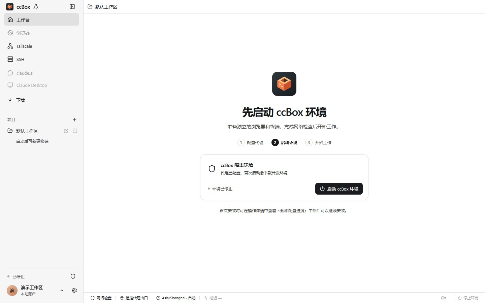

CCBox 把终端、浏览器、编辑器和官方 Claude Desktop 放进同一个工作台。Mac 用户可以在 macOS 客机里使用原生工具，Windows 用户可以在 Windows 客机里编译和运行项目，也可以选择轻量的 Debian 环境。项目按需共享，网络独立管理，工具与登录资料随环境保留。

你可以在自己的电脑上工作，也可以通过 SSH 连接自己的 Linux 服务器。离开电脑后，用手机接续同一份 Claude Code 会话、处理工具审批，或操作电脑上的浏览器与 Claude Desktop。

本手册描述当前开发构建的功能。公开安装包是否包含相应入口，以及各平台的验收范围，以对应发行说明为准。首次创建可选择“自动匹配本机系统版本”，匹配官方材料建立干净的客机；详细条件与当前验证范围见[选择客机系统](guest-systems.md)。

<figure class="guide-shot">
  
  <figcaption>CCBox 工作台启动界面预览。</figcaption>
</figure>

## 第一次使用

1. 阅读[安装与首次启动](installation.md)，安装适合电脑的 CCBox；按[选择客机系统](guest-systems.md)准备 macOS、Windows 或 Debian 环境。
2. 在[网络与代理](network.md)中导入自己的节点，应用代理后启动环境，等待关键检查通过。
3. 按[项目、终端与文件](workbench.md)打开一个项目，在 CCBox 内完成 Claude Code 授权，发出第一条消息。
4. 有多个 Claude 订阅时，继续配置[多账号与额度](accounts.md)。

## 按你想做的事查找

| 你想做什么 | 阅读哪篇 |
| --- | --- |
| 把安装、配置与排障交给自己的 Agent | [让 Agent 配置 CCBox](agent.md) |
| 安装应用、换盘、准备本机虚拟化 | [安装与首次启动](installation.md) |
| 使用与主机同类的系统、选择原生开发工具 | [选择客机系统](guest-systems.md) |
| 导入订阅、连接住宅代理、设置出口规则 | [网络与代理](network.md) |
| 打开项目、启动 Claude 终端、传文件与截图 | [项目、终端与文件](workbench.md) |
| 添加多个订阅、查看额度、分配或接续会话 | [多账号与额度](accounts.md) |
| 收藏网页、无痕浏览、清理 Cookie、安装扩展 | [浏览器与网站数据](browser.md) |
| 在 CCBox 内使用 Claude Desktop | [Claude Desktop](desktop.md) |
| 部署到无 KVM 的 VPS、连接服务器和管理远端项目 | [云端部署与 SSH](cloud.md) |
| 在 CCBox 登录私网，从本机与客机双向使用 SSH | [Tailscale 与 SSH 私网](tailscale.md) |
| 找到每一项设置，了解修改何时生效 | [设置参考](settings.md) |
| 换存储盘、调整 CPU 与内存、升级、备份或卸载 | [维护、资源与数据](maintenance.md) |
| 按错误现象恢复使用、导出诊断 | [故障排查](troubleshooting.md) |

## 本机与云端如何配合

本机模式下，所选的 macOS、Windows 或 Debian 虚拟机在电脑上运行。系统选择取决于主机的平台与虚拟化能力；明确打开的主机项目与环境共享，改动直接影响原文件。

云端模式下，终端、网页、工具、账户和网络配置属于所选服务器。桌面应用负责连接和显示；本机项目只有在明确授权后才临时共享。断开 SSH 会保留远端任务，停止远端环境才会结束任务。

## 先了解数据与网络边界

- 打开的项目可以被环境中的程序读取与修改。重要文件先备份；项目内的 `.git` 可读写，可以在 CCBox 内审查、暂存与提交代码。
- 同一环境的所有项目共用客机系统、工具、账户和文件系统。切换项目不会停止原任务，也不会撤销已授权的共享。
- CCBox 需要你自己的代理和 Claude 使用资格。网络检查通过表示当前配置和采样证据通过，无法保证第三方账户不受限制。
- 默认公网出站支持 IPv4 TCP，DNS 通过同一代理；公网 UDP、IPv6、ICMP，以及环境到主机或局域网的直连受限。主动启用 Tailscale 后，已授权的私网设备可通过独立通道连接。
- 关闭窗口、停止环境和退出账户的影响不同，操作前可查[关闭与退出](workbench.md#关闭与退出)。
